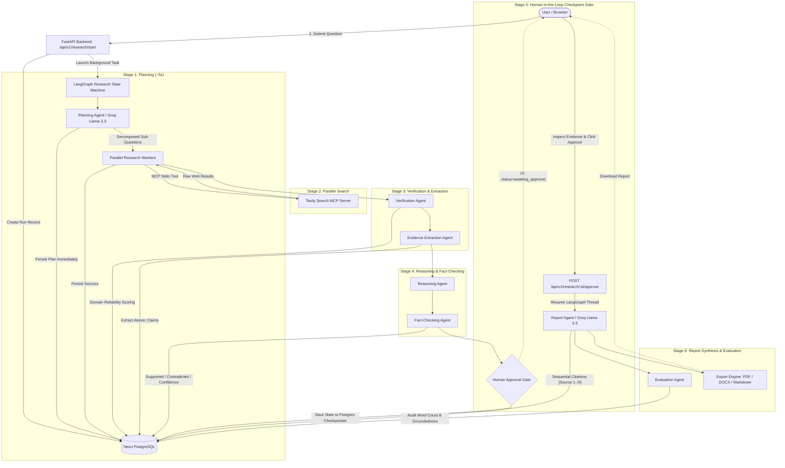

# Deepcite Master Workflow & Architecture Guide

A complete, end-to-end technical breakdown of the **Deepcite** platform: how it works, why each component was designed, how data flows through the agent mesh, and how to explain the entire system to technical interviewers, colleagues, or clients without missing a single detail.

---

## 📌 Table of Contents

1. [Executive Summary & The "Why"](#1-executive-summary--the-why)
2. [High-Level Architecture Diagram](#2-high-level-architecture-diagram)
3. [The 10-Stage Pipeline Deep Dive](#3-the-10-stage-pipeline-deep-dive)
   - [Stage 1: User Initiation, Auth & Workspace Scoping](#stage-1-user-initiation-auth--workspace-scoping)
   - [Stage 2: Supervisor Planning Agent & Instant Plan Persistence](#stage-2-supervisor-planning-agent--instant-plan-persistence)
   - [Stage 3: Parallel Research via Model Context Protocol (MCP)](#stage-3-parallel-research-via-model-context-protocol-mcp)
   - [Stage 4: Source Verification & Reliability Tiering](#stage-4-source-verification--reliability-tiering)
   - [Stage 5: Evidence Extraction Agent](#stage-5-evidence-extraction-agent)
   - [Stage 6: Claim Reasoning Agent](#stage-6-claim-reasoning-agent)
   - [Stage 7: Fact-Checking Agent & Confidence Scoring](#stage-7-fact-checking-agent--confidence-scoring)
   - [Stage 8: Human-in-the-Loop (HITL) Checkpoint Gate](#stage-8-human-in-the-loop-hitl-checkpoint-gate)
   - [Stage 9: Report Synthesis & Sequential Citation Grounding](#stage-9-report-synthesis--sequential-citation-grounding)
   - [Stage 10: Automated Evaluation & Multi-Format Export](#stage-10-automated-evaluation--multi-format-export)
4. [Database Schema & Checkpoint State Storage](#4-database-schema--checkpoint-state-storage)
5. [Production Infrastructure & Deployment](#5-production-infrastructure--deployment)
6. [Interview Talking Points & Tough Questions Guide](#6-interview-talking-points--tough-questions-guide)

---

## 1. Executive Summary & The "Why"

### The Problem with Single-Prompt LLM Research
When users ask standard LLMs (like ChatGPT or Claude) complex, analytical research questions (e.g., *"What are the latency and memory trade-offs of Speculative Decoding vs Medusa in serving open-weight LLMs?"*), the model attempts to generate a 1,500-word answer in a single forward pass. This creates major production problems:
1. **Hallucination of Benchmarks & Specifics**: The LLM guesses numbers, memory requirements, and citations from outdated training weights.
2. **Zero Factual Traceability**: Statements cannot be traced back to verified source text or empirical papers.
3. **Black-Box Process**: The user sees a loading spinner and has no idea what the model searched, what it found, or what evidence it discarded.
4. **Blind Trust vs Human Oversight**: Users are forced to either accept the generated report blindly or manually re-verify every claim.

### The Deepcite Solution
Deepcite treats research not as a text-generation task, but as a **verifiable, multi-stage agentic workflow**:
- **Decompose First**: Plan targeted sub-questions before searching.
- **Search with Standards**: Use the open **Model Context Protocol (MCP)** to search the live web.
- **Verify Before Reasoning**: Score sources deterministically (`Academic / Peer-Reviewed` vs `Verified Web`) and filter out untrusted scrapers.
- **Extract Atomic Evidence**: Break raw pages down into factual claim-evidence pairs.
- **Fact-Check Conclusions**: Cross-check claims against evidence to mark them `supported`, `contradicted`, or `uncertain`.
- **Human-in-the-Loop Gate**: Checkpoint the state into PostgreSQL and pause so a human reviewer can inspect the evidence before report generation.
- **Sequential Grounding**: Cite every factual sentence with clear sequential markers (`[Source 1]`, `[Source 2]`, ...).
- **Evaluate Objectively**: Audit report quality, citation coverage, and groundedness automatically.

---

## 2. High-Level Architecture Diagram



---

## 3. The 10-Stage Pipeline Deep Dive

### Stage 1: User Initiation, Auth & Workspace Scoping
1. The user logs in via the Next.js frontend (`/login`). The FastAPI backend issues a cryptographically signed **JWT Bearer Token** (`HS256`, 7-day expiration).
2. The user enters a research question on the `/dashboard` within a specific **Workspace** (multi-tenant workspace isolation).
3. The frontend issues a `POST /api/v1/research/start` request with `{ "workspace_id": "...", "question": "..." }`.
4. The backend initializes a `ResearchRun` database row with status `planning`.
5. Crucially, the endpoint **does not block**. It initiates the LangGraph graph inside a FastAPI `BackgroundTask` and returns the `research_run_id` immediately (<150ms). The frontend then redirects the user to `/research/{id}` and polls the status every 2 seconds.

---

### Stage 2: Supervisor Planning Agent & Instant Plan Persistence
- **Active Node**: `planning_agent`
- **Execution Time**: ~3–5 seconds
- **LLM Used**: Groq Cloud running `openai/gpt-oss-120b` (or Llama 3.3 70B) with strict JSON schema enforcement (`PlanningOutput`).
- **Prompt Goal**: Read the user's research query, identify ambiguity, and decompose it into:
  1. An overall **Decomposition Strategy** (e.g. *Comparative Benchmark & Architectural Trade-off Analysis*).
  2. Exactly **3 targeted sub-questions** designed for orthogonal web searches (e.g., Sub-Q1: End-to-end latency benchmarks, Sub-Q2: Memory/KV-cache overhead, Sub-Q3: Throughput scaling).
- **The Immediate Persistence Innovation**:
  In early versions of Deepcite, users waited 2 minutes with a generic loading spinner before seeing anything. In Deepcite v3, the moment `planning_agent` completes, the backend saves the `ResearchPlan` directly to the `research_plans` PostgreSQL table.
  - The UI fetches `GET /api/v1/research/{id}/plan` and **immediately renders the interactive strategy card within 5 seconds**. The user instantly sees what the agent is planning to investigate while the search workers begin.

---

### Stage 3: Parallel Research via Model Context Protocol (MCP)
- **Active Node**: `research_agent`
- **Protocol**: **Model Context Protocol (MCP)** via Anthropic's open standard.
- **Implementation**: The backend spawns a Tavily Search MCP Server over standard input/output (`stdio`).
- **Parallel Fan-out**:
  - The LangGraph supervisor creates 3 parallel research worker branches—one for each sub-question.
  - The 3 workers execute concurrently using `asyncio.gather` bounded by a semaphore to respect provider rate limits.
  - Each worker queries Tavily MCP for the top 5 high-relevance technical sources.
- **Normalization & Deduplication**:
  - The pipeline extracts the raw URL, page title, and content.
  - Exact URLs and trailing slashes are normalized (`urlunparse`) to prevent duplicate sources.
  - Up to 15 raw search results are persisted in the `sources` table linked to the run.

---

### Stage 4: Source Verification & Reliability Tiering
- **Active Node**: `verifier_agent`
- **Philosophy**: Factual grounding cannot rely on an LLM's subjective feeling of trust. Source reliability is computed **deterministically using mathematical domain scoring**.
- **Scoring Algorithm**:
  - **Academic / Peer-Reviewed (Score 0.85 – 1.00)**: Domains matching authoritative repositories (e.g. `arxiv.org`, `nature.com`, `ieee.org`, `acm.org`, `.edu`, `.gov`).
  - **Verified Technical Web Sources (Score 0.70 – 0.84)**: Official engineering blogs, documentation portals, and peer-reviewed tech publications (e.g. `huggingface.co`, `github.com`, `pytorch.org`).
  - **General Web Sources (Score 0.50 – 0.69)**: Mainstream tech journalism, medium posts, community forums.
  - **Low Quality / Scrapers (Score < 0.50)**: Unverified blogs, aggregators, forums.
- **Quality Filter**: Sources scoring below `0.50` are automatically filtered out before report generation, protecting the report from misinformation.
- **UI Representation**: Rather than confusing users with raw numbers (e.g., `0.85`), Deepcite displays contextual badges:
  - 🟢 **`Academic / Peer-Reviewed`** (emerald)
  - 🔵 **`Verified Web Source`** (blue)

---

### Stage 5: Evidence Extraction Agent
- **Active Node**: `evidence_agent`
- **Execution**: The agent processes the filtered sources and extracts atomic, factual statements.
- **Output Schema**:
  ```json
  {
    "items": [
      "Speculative decoding achieves 2x speedup on batch size 1 but drops to 1.1x as batch size reaches 32.",
      "Medusa uses multiple decoding heads atop the frozen transformer backbone, requiring batch-invariant kernels."
    ]
  }
  ```
- Each extracted claim is stored in the `evidence` table with foreign keys linking back to `research_run_id` and `source_id`.

---

### Stage 6: Claim Reasoning Agent
- **Active Node**: `reasoning_agent`
- **Responsibility**: Unprocessed evidence items are just disjointed facts. The Reasoning Agent synthesizes them into coherent, logical arguments.
- It identifies:
  - Consensus points across multiple independent sources.
  - Conflicts or trade-offs between different papers.
  - Gaps where empirical data is lacking.
- It tags each reasoning proposition with `supporting_source_indexes` and `contradicting_source_indexes`.

---

### Stage 7: Fact-Checking Agent & Confidence Scoring
- **Active Node**: `fact_checker_agent`
- **Responsibility**: Cross-verifies every reasoned claim against the extracted evidence.
- **Tri-State Status**:
  - `supported`: The extracted evidence directly substantiates the claim.
  - `contradicted`: The extracted evidence refutes or disproves the claim.
  - `uncertain`: The evidence is incomplete or inconclusive.
- **Deterministic Mathematical Confidence Formula**:
  Instead of asking an LLM "how confident do you feel on a scale of 1 to 100?", Deepcite computes confidence mathematically:
  $$\text{Confidence} = f(\text{status}, \text{supporting\_source\_reliabilities}, \text{contradicting\_source\_reliabilities})$$
  - If a claim is supported by 3 independent sources with reliability `0.90`, confidence reaches `~95%`.
  - If a claim has contradicting evidence from an academic source, confidence is penalized heavily.
  - Claims are persisted into the `claims` table. In the UI, confidence is formatted cleanly as a percentage (e.g., `Confidence: 86%`).

---

### Stage 8: Human-in-the-Loop (HITL) Checkpoint Gate
- **Active Node**: `approval_gate`
- **How It Works Under the Hood**:
  - Deepcite uses **LangGraph PostgreSQL Checkpointer** (`psycopg`).
  - When the graph reaches `approval_gate`, it executes an interrupt. The graph serializes the entire state (question, plan, verified sources, evidence, claims, fact-checks) into the `checkpoints` table in PostgreSQL.
  - The research run status in the database is set to `awaiting_approval`.
- **The User Experience**:
  - The research detail page transitions to the **Evidence Review Modal**.
  - The human reviewer can inspect every extracted finding, read the source snippet, see the source URL, and verify the reliability tier.
- **Bi-Directional Review**:
  1. **Approve Research**: The user clicks "Approve Research". The frontend calls `POST /api/v1/research/{id}/approve`. The backend retrieves the LangGraph checkpoint by `thread_id=research_run_id` and resumes execution right where it paused—without having to re-search or re-extract anything!
  2. **Reject Research**: The user clicks "Reject". The run is marked `rejected` or cancelled, allowing the user to refine their prompt.

---

### Stage 9: Report Synthesis & Sequential Citation Grounding
- **Active Node**: `report_agent`
- **LLM**: Groq Cloud running Llama 3.3 70B Versatile with temperature `0.2` (for factual precision).
- **Enforced Document Structure**:
  1. Title (`# <title>`)
  2. `## Methodology`
  3. `## Findings`
  4. `## Analysis and Synthesis`
  5. `## Limitations and Risks`
  6. `## Recommendations`
  7. `## Conclusion`
- **The Sequential Citation Engine (Solved in v3)**:
  - *The Problem*: In naive multi-agent systems, if raw search results #0 and #2 are dropped during verification, the report generator cites `[Source 2]` and `[Source 4]`. To readers, citations starting at `[Source 2]` looks broken or missing!
  - *The Deepcite Solution*: Before prompting the report writer, `report_agent` re-indexes all verified sources into contiguous `0..N-1` indices. The LLM is given:
    - `[Source 1]` Title A (rel 0.95)
    - `[Source 2]` Title B (rel 0.88)
    - `[Source 3]` Title C (rel 0.75)
  - The report writer cites `[Source 1]`, `[Source 2]`, `[Source 3]`.
  - The database persists `inline_marker = "[Source 1]"`.
  - The UI and document exporters display a perfectly sequential citation list starting at `[Source 1]` with zero gaps.
- **Quantitative Chart Generation**:
  - `identify_chartable_data` analyzes numeric comparisons in the findings (e.g. latency numbers across batch sizes).
  - If suitable data exists, it renders a high-resolution PNG chart via matplotlib/ReportLab and persists it in `report_assets`.

---

### Stage 10: Automated Evaluation & Multi-Format Export
- **Active Node**: `evaluation_agent`
- **Non-Blocking Execution**: Runs asynchronously after report synthesis so the user never waits for evaluation metrics to read the report.
- **Automated Quality Dimensions**:
  1. **Planning Quality** (Groq Judge): Evaluates if sub-questions comprehensively addressed the root query.
  2. **Search Quality** (Groq Judge): Evaluates whether retrieved sources match the domain requirements.
  3. **Citation Coverage** (Deterministic): Checks the ratio of factual statements that include an inline citation.
  4. **Groundedness & Hallucination Detection** (Groq Judge): Audits the generated report against the collected evidence to ensure no external, unverified claims were introduced.
  5. **Word Count & Structure Compliance**: Verifies the report meets the target length (1,200–1,500 words) and contains all required analytical sections.
- **Multi-Format Export Engine (`renderers.py`)**:
  - **Markdown (`.md`)**: GitHub-flavored markdown with embedded asset links and References.
  - **PDF (`.pdf`)**: Formatted using ReportLab with custom typography, clean page margins, title styling, and high-resolution chart images.
  - **Word DOCX (`.docx`)**: Styled Microsoft Word document formatted via `python-docx` for enterprise workflows.

---

## 4. Database Schema & Checkpoint State Storage

Deepcite uses a normalized relational schema on **Neon Serverless PostgreSQL**:

| Table | Purpose | Key Columns |
| :--- | :--- | :--- |
| `users` | User authentication & credentials | `id`, `email`, `hashed_password`, `is_active` |
| `workspaces` | Multi-tenant workspace scoping | `id`, `owner_id`, `name`, `created_at` |
| `research_runs` | Research query lifecycle & status | `id`, `workspace_id`, `question`, `status`, `completed_at` |
| `research_plans` | Decomposed strategy & sub-questions | `id`, `research_run_id`, `strategy`, `sub_questions` (JSONB) |
| `sources` | Retrieved web documents & reliability | `id`, `research_run_id`, `url`, `title`, `reliability_score` |
| `evidence` | Atomic factual claims from sources | `id`, `research_run_id`, `source_id`, `claim_text` |
| `claims` | Reasoned conclusions & fact-check status | `id`, `research_run_id`, `text`, `fact_check_status`, `confidence_score` |
| `reports` | Final synthesized research report | `id`, `research_run_id`, `content_markdown`, `overall_confidence_score` |
| `citations` | Explicit links from text to source/claim | `id`, `report_id`, `claim_id`, `source_id`, `inline_marker` |
| `evaluations` | Quality layer metrics & audit rationale | `id`, `research_run_id`, `dimension`, `score`, `details` (JSONB) |
| `report_assets` | Quantitative rendered PNG charts | `id`, `report_id`, `file_path`, `caption`, `asset_type` |
| `checkpoints` | LangGraph state persistence | `thread_id`, `checkpoint_ns`, `checkpoint_id`, `checkpoint` (BLOB) |

---

## 5. Production Infrastructure & Deployment

- **Frontend**: Next.js 16 (App Router, React 19, Tailwind CSS, Lucide icons) deployed on **Vercel** (`https://deepcite.vercel.app`).
- **Backend**: FastAPI (Python 3.12, Clean Architecture, Pydantic v2, SQLAlchemy Async) deployed on **Render** (`https://deepcite-967b.onrender.com`).
- **Database**: Serverless PostgreSQL on **Neon** with connection pooling.
- **Search Tooling**: **Tavily Search MCP Server** running via Node stdio transport.
- **LLM Provider**: **Groq Cloud** (Llama 3.3 70B Versatile) for ultra-low latency inference, with Google Gemini as a documented fallback.
- **Observability**: **LangSmith** for distributed tracing across all graph nodes, LLM prompts, and tool calls.
- **CI/CD**: GitHub Actions workflow running Ruff linting, Pytest test suites, and Docker image builds on every pull request.

---

## 6. Interview Talking Points & Tough Questions Guide

When discussing Deepcite in an AI Engineering or System Design interview, use these structured talking points:

### The 2-Minute Elevator Pitch
> *"Deepcite is an evidence-grounded multi-agent research platform built to solve the hallucination and traceability problems in single-shot LLMs. Instead of generating a research paper in one prompt, Deepcite coordinates specialized agents using LangGraph and the Model Context Protocol (MCP). It starts by decomposing a query into targeted sub-questions, executes parallel web searches, scores source reliability deterministically, extracts atomic evidence, and fact-checks synthesized claims. Before generating the final report, the system pauses at a PostgreSQL-backed checkpoint for human review, allowing users to inspect the evidence bundle and approve or reject the run. The final report is synthesized with sequential inline citations (`[Source 1]`, `[Source 2]`), evaluated for groundedness, and exported to PDF, Word, or Markdown."*

### Key Trade-Offs & Why You Made Them

#### Q1: "Why did you use LangGraph instead of CrewAI or AutoGen?"
* **Answer**: *"CrewAI and AutoGen are great for conversational multi-agent brainstorming, but they are nondeterministic and hard to control in production. Deepcite required a deterministic state machine with strict branching, fan-out parallelization, and durable checkpointing. LangGraph allowed us to represent the research workflow as a directed graph where state transitions are explicit, and human-in-the-loop approval can pause and resume execution directly from a PostgreSQL checkpointer without losing state."*

#### Q2: "Why use Model Context Protocol (MCP) instead of a custom Python API wrapper?"
* **Answer**: *"MCP provides an open, vendor-neutral standard for connecting LLMs and agent runtimes to external tools and data sources. By using the Tavily MCP server over stdio, our search tool is decoupled from our application code. If we want to swap search engines, add a local filesystem reader, or connect an enterprise PostgreSQL database tomorrow, we simply attach another MCP client without modifying our agent code."*

#### Q3: "How do you handle LLM hallucinations?"
* **Answer**: *"We attack hallucination at three independent layers:
1. **Source Reliability Screening**: We filter out low-reliability domains (score < 0.50) before evidence extraction.
2. **Deterministic Fact-Checking**: Claims must have explicit supporting evidence IDs, and confidence is computed mathematically based on source reliability rather than LLM self-reporting.
3. **Automated Evaluation Layer**: An independent evaluation agent runs post-generation to calculate groundedness and citation coverage, auditing the text against the evidence bundle."*

#### Q4: "How does the system handle failures or crashes mid-research?"
* **Answer**: *"Because every LangGraph node transition commits a checkpoint to PostgreSQL, research runs are crash-resilient. If the backend process restarts during research or while waiting for human approval, the run can be resumed from its latest checkpoint using the research run ID, avoiding redundant search API costs and duplicate database records."*
